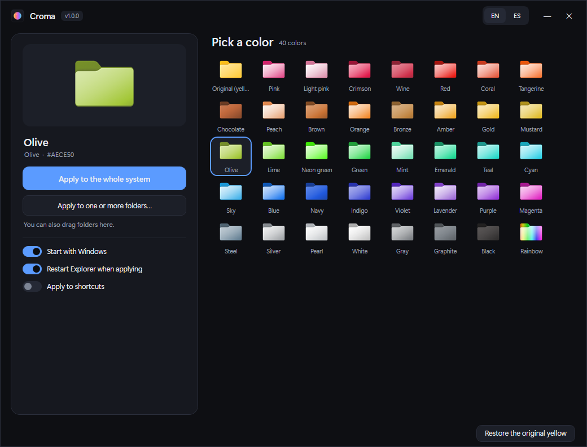
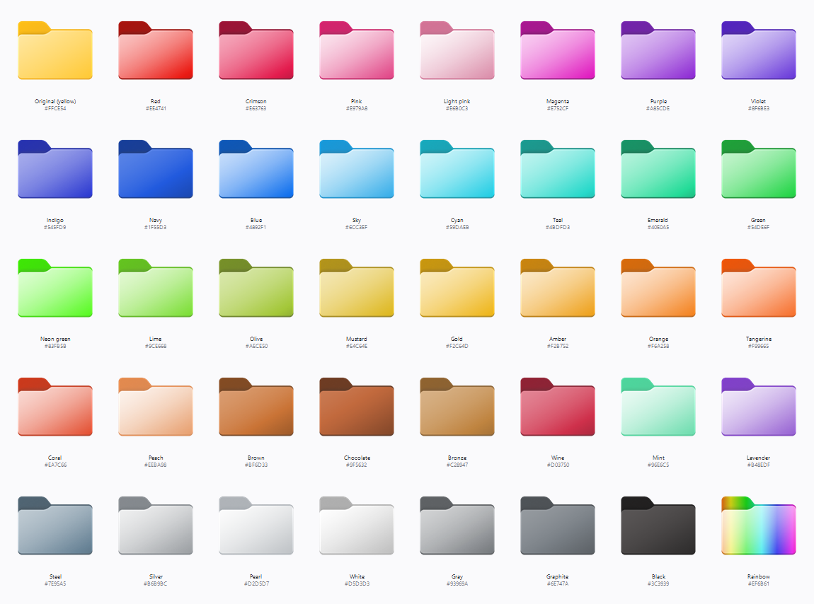

# Croma

**Coloured folders for Windows, without breaking the look of Windows.**



Okay, story time. I keep my stuff in folders. Lots of folders. And at some point my
desktop turned into a wall of identical yellow rectangles where finding anything meant
reading filenames like a maniac. So I built this: pick a colour, every folder follows.
The icons are not some flat, ugly replacement — they are the *real* Windows 11 folder,
re-tinted, so the gloss and the depth stay exactly where Microsoft put them.

It lives in the tray, it starts with Windows, and it has a context menu. It's the tool
I wanted and couldn't find without installing a browser toolbar from 2009.

---

## What it does

- **40 colours** — from the original yellow to black, white, pastel, neon and a rainbow
  folder, because why not.
- **One colour for everything** — a machine-wide switch that repaints every folder in
  Explorer: desktop, drives, dialog boxes.
- **Per-folder colours** — right-click a folder, pick a colour, done. These override the
  global one, so you can have "blue = work" and "red = do not open until Monday".
- **Drag & drop** — throw a bunch of folders onto the window to paint them all at once.
- **It remembers** — colours survive reboots; anything Windows loses gets repaired on
  startup.
- **English and Spanish** — switch with the EN / ES buttons, top right.
- **Actually reversible** — "restore the original yellow" puts your registry and your
  folders back exactly how they were. I keep a backup of the original values, I'm not a
  monster.

## The 40 colours



Every one of them is generated from the same source icon (the folder from `shell32.dll`),
so they all keep the Windows shading. Including a rainbow gradient one, which I made
purely to see if I could.

## How it works (and why it's like this)

Two completely different mechanisms, because Windows treats folders and everything else
differently:

**Global colour** → the folder icon comes from `HKLM\...\Explorer\Shell Icons` and
`HKLM\Software\Classes\Directory\DefaultIcon`. Writing those needs administrator rights,
so the app asks for UAC once per colour change. That's Windows' rule, not mine.

**Per-folder colour** → a hidden `desktop.ini` with `IconResource=` pointing at the
colour's `.ico`, plus the read-only attribute that makes Explorer actually believe it.
No admin needed, no system files touched.

**And then there's the icon cache.** This is the part that cost me an entire evening.
Explorer caches folder icons per path and refuses to notice you changed `desktop.ini`.
I tried `SHChangeNotify` (sync and async), `SHCNE_UPDATEITEM`, bumping the folder's
change stamp, `ie4uinit.exe -show`... and proved with screenshot hashes that the desktop
just sat there showing the old colour. The only thing that reliably works is clearing the
icon cache and restarting Explorer. So that's what it does after applying. The taskbar
blinks for a couple of seconds. You can turn it off in the options, and then wonder why
some folders look stale — your call, I've made mine.

## Install

Grab `Croma.exe` from the [releases](../../releases) page and run it. That's it.

Requirements: Windows 10/11 (64-bit) and the [.NET 10 Desktop
Runtime](https://dotnet.microsoft.com/download/dotnet/10.0). If you're on an older
runtime the app will tell you, it won't just die silently.

First run it sets itself up: tray icon, start-with-Windows, desktop shortcut and the
context menu entry. It puts the 40 `.ico` files in `Pictures\FolderHue Icons` so you can
also use them by hand from any *Properties → Change icon* dialog. No, the folder is not
called "Croma Icons" — I renamed the app halfway through and never went back to fix the
path. I'm sorry.

## Using it

**Global colour:** open Croma from the tray → pick a colour → *Apply to the whole
system* → say yes to the UAC prompt.

**One folder:** right-click it → *Folder color* → pick. On Windows 11 that entry lives
behind *Show more options*, or just hold **Shift** while right-clicking, which skips
straight to the classic menu. That's a Windows 11 thing, not something I can fix without
shipping a signed MSIX package.

**Several folders:** select them in Explorer, *Shift*+right-click, pick a colour. Or drag
them onto the Croma window and press the button.

## The icons in Pictures (and the taskbar trick)

On install, Croma writes all 40 colours as real `.ico` files into:

```
C:\Users\<you>\Pictures\FolderHue Icons\
   01 - Original (yellow).ico
   02 - Red.ico
   03 - Crimson.ico
   ...
   40 - Rainbow.ico
```

Yes, the folder says *FolderHue* and not *Croma*. I renamed the app halfway through,
the folder stayed. It annoys me too. (The app data lives in `%LOCALAPPDATA%\FolderHue`
for the same reason.)

Each file is a proper multi-resolution icon (16, 20, 24, 32, 40, 48, 64, 96, 128 and
256 px), so it looks sharp on the taskbar, on the desktop and in big thumbnail views.
They are regenerated every time you change colours, so they never go stale.

**Why this matters:** Windows will not let any app recolour the File Explorer icon on the
taskbar. That icon belongs to `explorer.exe`, always running, baked into a signed system
binary. What you *can* do is give yourself a folder shortcut in the colour you want and pin
that instead. Same thing visually, zero system files harmed:

1. Right-click your shortcut (or make one to `explorer.exe`, or to any folder you like).
2. **Properties → Change icon… → Browse…**
3. Go to `Pictures\FolderHue Icons` and pick a colour, say `07 - Blue.ico`.
4. OK, then right-click the shortcut → **Pin to taskbar**.

You now have a folder in your colour sitting on the taskbar, and it opens Explorer
normally. Croma cannot do that last pinning step for you: Windows 11 silently ignores
programmatic pin requests (the shell even answers "success" and then does nothing, which
I found out the fun way). Hence one manual right-click, once.


## The stuff Windows will not let me do

I'm being upfront because I spent too long on these:

- **The File Explorer icon on the taskbar cannot be recoloured.** That button is
  `explorer.exe` itself, always running. Its icon is baked into a signed system binary.
  Changing it means patching Windows or injecting code into Explorer. I tested the
  official-ish routes — `AppUserModelID\IconUri`, `WM_SETICON` on the live window, the
  `taskbarpin` verb (which cheerfully returns "success" and does absolutely nothing).
  None of them work. I'm not going to patch `explorer.exe` and get you a broken Start
  menu with the next Windows Update.
- **Individual files can't get a colour badge.** Windows has no per-file icon override;
  badges need a shell overlay extension, which is a different (and riskier) project.

Folders, on the other hand, are fully covered.

## Build it yourself

```bash
git clone https://github.com/SoyAntonioJimenez/croma.git
cd croma
dotnet build src/Croma.App/Croma.App.csproj
```

Three projects:

- `src/Croma.Core` — the interesting bit: extracts the system folder icon, re-tints it by
  mapping luminance onto a colour ramp, bakes multi-size `.ico` files.
- `src/Croma.App` — WPF app, tray icon, context menu, registry and `desktop.ini`.
- `src/Croma.Cli` — small tool I used to generate the palette and debug icon extraction.

Want to add a colour? Add one entry to the palette table in `Croma.Core/FolderColor.cs`
and the whole app picks it up: icons, menu, picker, swatches.

## License

MIT. Go wild.
